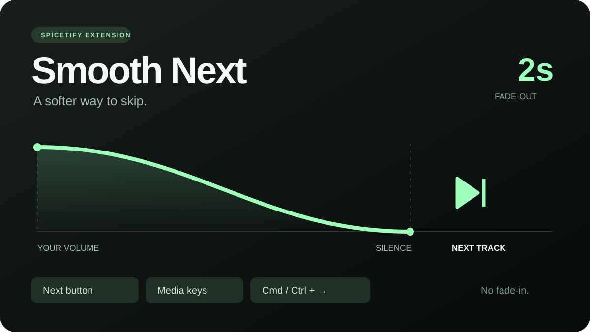

# Smooth Next



**A two-second fade-out before you skip. No fade-in.**

Smooth Next is a dependency-free [Spicetify](https://spicetify.app/) extension. Press Next and the current song fades to silence over two seconds. Spotify then advances its own queue, and your original volume returns immediately.

[Download ZIP](https://github.com/enginhu/spicetify-smooth-next/releases/latest) · [Türkçe kullanım kılavuzu](README.tr.md) · [Release notes](CHANGELOG.md)

## Controls

- The existing **Next** button, including Enter/Space when the button is focused.
- **Cmd + Right Arrow** on macOS or **Ctrl + Right Arrow** on Windows/Linux, outside text fields and sliders.
- **Next-track media keys** routed through Spotify's `PlayerAPI.skipToNext()` / Media Session `nexttrack` handler. This shared API route also works without a focused Spotify window.
- DOM `MediaTrackNext` keyboard events, on clients that dispatch them.
- **SDCX / SDINNOVATION SIDE-KEYBOARD knob on macOS**, including when Spotify is in the background, with the bundled [local companion](macos/README.tr.md).

Spotify Connect commands and operating-system commands that bypass Spotify's JavaScript player cannot be intercepted by this extension. Hardware/OS routing varies; the extension cannot guarantee every external media controller.

## Install

Download `smooth-next-1.2.0.zip` from [GitHub Releases](https://github.com/enginhu/spicetify-smooth-next/releases/latest) and extract it. On macOS/Linux, open a terminal in the extracted folder:

```sh
bash install.sh
```

The installer finds your existing Spicetify configuration, copies only `smooth-next.js`, adds it to the extension list, and runs `spicetify apply`. Spotify may restart. An existing copy is backed up as `smooth-next.js.bak`.

Alternatively, copy `smooth-next.js` into the `Extensions` folder next to your Spicetify configuration (`spicetify -c` shows the config path). Default locations:

| System | Extension directory |
| --- | --- |
| macOS / Linux | `~/.config/spicetify/Extensions/` |
| Windows | `%appdata%\spicetify\Extensions\` |

Then run:

```sh
spicetify config extensions smooth-next.js
spicetify apply
```

Toggle **Smooth Next · 2 sn fade-out** in the Spotify profile menu. Your preference is saved locally.

For the SDCX knob on macOS, run `bash macos/install.sh` instead. It installs both extensions and a per-user companion that starts at login. The tested keypad has USB vendor/product IDs `0816:2474`. Only its Next command is temporarily mapped to reserved global hotkey F20, then forwarded over loopback to this extension. Previous-track and volume controls retain their mappings. The helper restores native Next when the extension disconnects, is disabled, or the helper exits. Details and removal: [macOS companion guide](macos/README.tr.md).

## Behavior

- Uses your existing volume; never restores to a fixed 100% level.
- Ignores additional Next commands while a transition is running.
- Restores volume if playback is paused, another track starts, or the transition times out.
- Cancels the fade when you use Spotify's volume control, mute control, or volume shortcut.
- Leaves paused, silent, podcast, and ad playback on Spotify's normal path.
- Leaves explicit queue-item selection unchanged.
- Does not add a fade to automatic track endings and does not overlap two songs.

The visible volume slider moves during the fade. Other extensions issuing a generic next-track command through the shared player API also use the fade. Extensions that change volume concurrently may conflict. The fade lasts approximately two seconds; playback acknowledgement, loading, and JavaScript scheduling can add a short delay before the next song starts.

## Remove

```sh
spicetify config extensions smooth-next.js-
spicetify apply
```

## Development and verification

No npm install or build step is required:

```sh
node --check smooth-next.js
node --test smooth-next.test.cjs
```

To build the complete release ZIP from a source checkout, run `bash macos/build.sh` on macOS with Xcode Command Line Tools, then `python3 scripts/package.py`. The ZIP includes the compiled companion; the Git repository contains its Swift source. The companion targets macOS 13 or later; the bundled release binary is for Apple Silicon.

The automated suite covers volume timing, startup API replacement, stale buffering flags, keyboard commands, the shared background media-key route, duplicate commands, cancellation, errors, and cleanup. The original button transition was also measured inside Spotify 1.3.9.2039 with Spicetify 2.46.4 on macOS: volume was `1` initially, `0.529` at 1004 ms, and `0.001` at 2001 ms; by 2202 ms the next track was selected and volume was restored to `1`. This is player-state telemetry, not an audio waveform measurement.

Spicetify and Spotify APIs can change. The extension refreshes references if Spotify replaces its Player object and feature-detects the shared `skipToNext` API. It does not replace Spotify's Media Session handlers.

Version 1.1.0 also passed 31 automated tests. A live call to `Spicetify.Platform.PlayerAPI.skipToNext()` on the same client showed volume `0.529` at 1002 ms, `0.001` at 2001 ms, and the next track at restored volume `1` by 2251 ms. This verifies the shared API route; a physical hardware media key was not tested.

Version 1.2.0 passed 34 tests. The user physically turned the SDCX knob with Spotify in the background and confirmed the fade. Measured from the first observed active fade: volume was `0.529` at 959 ms, `0` at 2002 ms, and the next track was playing at restored volume `1` by 2080 ms. Stopping the companion restored both matching HID services' previous empty keymaps.

## Privacy

The base extension sends no network requests and collects no listening data. It reads playback state and changes playback volume/Next locally. The optional knob module connects only to `127.0.0.1:17643`; it exchanges Next commands, acknowledgements and an enabled heartbeat, without song metadata. The server accepts the Spotify origin and binds only to loopback. No input-monitoring or Accessibility permission, event tap, or firmware modification is used. The extension writes `smooth-next:enabled` in Spicetify local storage; the companion keeps its mapping recovery file and operational logs in `~/Library/Application Support/Smooth Next/`.

## License

[MIT](LICENSE). An independent community extension; not affiliated with Spotify or Spicetify.
